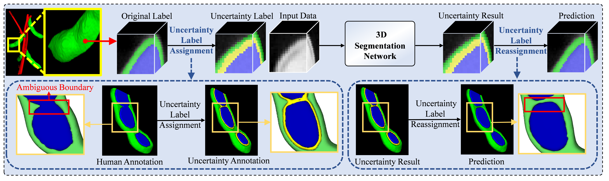

# Segmentation with Explicit Uncertainty: Toward X-ray CT-Based Phenotyping of Living Soybean Seed Growth for Precision Breeding

This repository contains the code and dataset for the paper **"Segmentation with Explicit Uncertainty: Toward X-ray CT-Based Phenotyping of Living Soybean Seed Growth for Precision Breeding,"** accepted at **ACM Multimedia 2026 (MM '26)**.

[Weizhen Liu<sup>1</sup>](https://orcid.org/0009-0000-0000-0000), [Chang Chi<sup>1</sup>](https://orcid.org/0009-0004-9433-3283), [Chang Liu<sup>1</sup>](https://orcid.org/0009-0007-3764-5207), [Shilin Chen<sup>1</sup>](https://orcid.org/0009-0005-2838-7539), [Yihao Fan<sup>1</sup>](https://orcid.org/0009-0001-3804-5672), [Jiayu Tan<sup>1</sup>](https://orcid.org/0009-0007-4389-8569), [Haoyang Su<sup>2</sup>](https://orcid.org/0009-0001-0899-6274), [Xiaohui Yuan<sup>3,4,\*</sup>](https://orcid.org/0000-0003-0661-5332), [Weijuan Hu<sup>5,\*</sup>](https://orcid.org/0000-0001-7332-9200), [Nanqing Dong<sup>6,7,\*</sup>](https://orcid.org/0000-0001-5014-1993)

<sup>1</sup>School of Artificial Intelligence, Wuhan University of Technology, Wuhan, Hubei, China

<sup>2</sup>Australian Institute for Machine Learning, The University of Adelaide, Adelaide, Australia

<sup>3</sup>Jilin Provincial Key Laboratory of MycoPhenomics, Changchun, Jilin, China

<sup>4</sup>Yazhouwan National Laboratory, Sanya, Hainan, China

<sup>5</sup>Laboratory of Advanced Breeding Technologies, Institute of Genetics and Developmental Biology, Chinese Academy of Sciences, Beijing, China

<sup>6</sup>Shanghai Innovation Institute, Shanghai, China

<sup>7</sup>Shanghai Artificial Intelligence Laboratory, Shanghai, China

{liuweizhen, changchi, chang\_liu, shilinchen, fanyihao, tjy2023305211, yuanxiaohui}@whut.edu.cn, haoyang.su@adelaide.edu.au, wjhu@genetics.ac.cn, nanqing.dong@sii.edu.cn

\* Corresponding authors: Xiaohui Yuan, Weijuan Hu, Nanqing Dong.

[](https://doi.org/10.1145/3767308.3836144)
[](https://github.com/)
[](https://creativecommons.org/licenses/by-nc-nd/4.0/)



## Overview

- [Segmentation with Explicit Uncertainty: Toward X-ray CT-Based Phenotyping of Living Soybean Seed Growth for Precision Breeding](#segmentation-with-explicit-uncertainty-toward-x-ray-ct-based-phenotyping-of-living-soybean-seed-growth-for-precision-breeding)
  - [Overview](#overview)
  - [Motivation and Design](#motivation-and-design)
  - [Dataset](#dataset)
  - [Environment Setup](#environment-setup)
  - [Citations](#citations)

## Motivation and Design

The motivation behind this study arises from the critical need for non-destructive, *in vivo* monitoring of seed development in precision breeding. Analyzing the growth dynamics of soybean seeds is essential for understanding their developmental patterns and quantifying phenotypic traits, which can significantly contribute to breeding plants with higher yields, better quality, and greater economic value. However, seed growth is enclosed within pods, and conventional studies rely on destructive sampling that harvests pods at discrete time points, interrupting the natural growth cycle and preventing the capture of individual seed dynamics. Although recent X-ray CT systems enable non-invasive imaging, most are physically constrained and cannot accommodate entire plants, restricting data to single time points on excised structures. To address this gap, the study introduces the **SoySeedCT** dataset, the first public time-series CT dataset designed specifically for studying soybean seed growth, acquired by scanning living pods across 10 key growth stages.

To address the challenge of indistinct seed-pod boundaries, the study proposes an **Uncertainty Labeling Strategy (ULS)**, a simple yet robust model-agnostic method for 3D segmentation. This method explicitly marks boundary voxels as an *"uncertainty"* class during training and dynamically reassigns them to categories of interest during inference based on intensity and spatial information. This approach reduces boundary errors caused by ambiguous seed-pod regions and enables accurate segmentation, thereby supporting downstream phenotypic analysis.

## Dataset

The dataset comprises 100 high-resolution X-ray CT scans of living soybean plants, spanning 10 cultivars and 10 growth stages. These scans were acquired using a plant X-ray CT system, where the X-ray dosage was verified by extensive experiments to ensure accurate visualization of soybean pod and seed structures without impairing normal plant growth. Over more than one month, 10 scans were performed at different time points for each plant, with efforts made to keep the plant position consistent at each timepoint. Each scan contains 450 slices, each slice with a resolution of 512 × 512 and a voxel size of 0.0258 mm³.

Detailed voxel-level annotations were created by seven domain experts with field experience, who rigorously reviewed the scans to delineate the boundaries between seeds and pods. These human expert annotations are considered the golden-standard ground truth, including precise labeling of seed and pod voxels as well as other soybean plant components such as stems. Each scan takes an expert more than 10 hours to annotate, and all final annotations were verified by at least 3 experts to achieve consensus. To the best of our knowledge, SoySeedCT is the first publicly available time-series dataset specifically designed for studying seed growth dynamics through live-plant temporal scans with human annotations.

If you need the complete dataset, please download the **SoySeedCT Dataset User Agreement** and read the relevant regulations. If you agree to the regulations, please fill in the relevant user information in the user agreement ([authorization date] and [electronic signature] at the end of the agreement). Send the PDF format of the user agreement to the email **<liuweizhen@whut.edu.cn>**. After review, we will send the download link for the complete dataset via email.

## Environment Setup

- Python 3.8
- PyTorch 1.11 or above (CUDA 11.8 recommended)
- MONAI (pip install monai) for 3D segmentation networks, transforms and metrics
- SimpleITK, nibabel, scikit-learn, scipy, patchify (pip install -r requirements.txt)
- Ubuntu or CentOS (Windows not recommended)
- Preferably use GPU for training (≥ 24 GB memory)
- For detailed environment setup, refer to requirements.txt

## Citations

Please cite our paper in your publications if our methods and dataset are helpful to your research. The BibTeX is as follows:

```bibtex
@inproceedings{liu2026soyseedct,
  title     = {Segmentation with Explicit Uncertainty: Toward X-ray CT-Based Phenotyping of Living Soybean Seed Growth for Precision Breeding},
  author    = {Liu, Weizhen and Chi, Chang and Liu, Chang and Chen, Shilin and Fan, Yihao and Tan, Jiayu and Su, Haoyang and Yuan, Xiaohui and Hu, Weijuan and Dong, Nanqing},
  booktitle = {Proceedings of the 34th ACM International Conference on Multimedia (MM '26)},
  year      = {2026},
  month     = {11},
  address   = {Rio de Janeiro, Brazil},
  publisher = {ACM},
  doi       = {10.1145/3767308.3836144},
  url       = {https://doi.org/10.1145/3767308.3836144}
}
```

